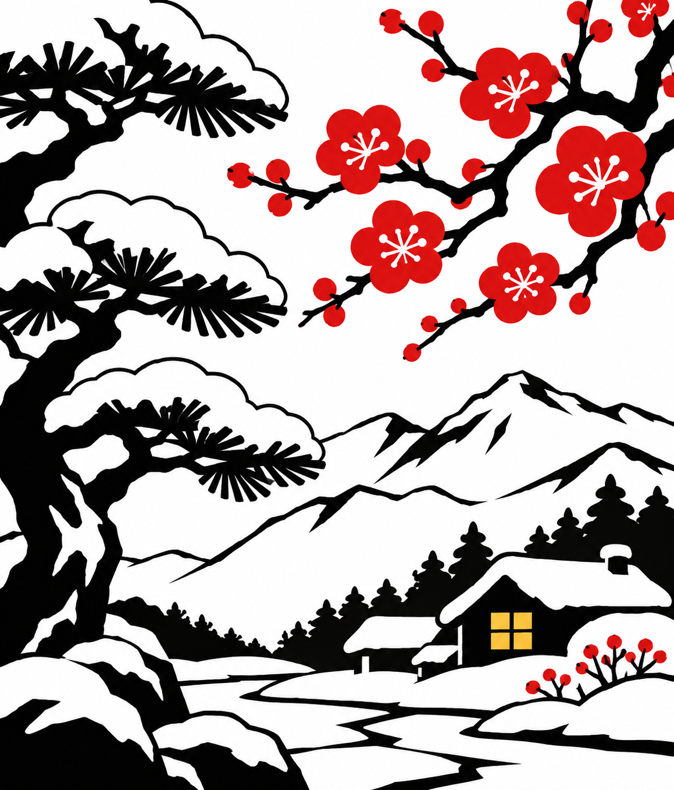
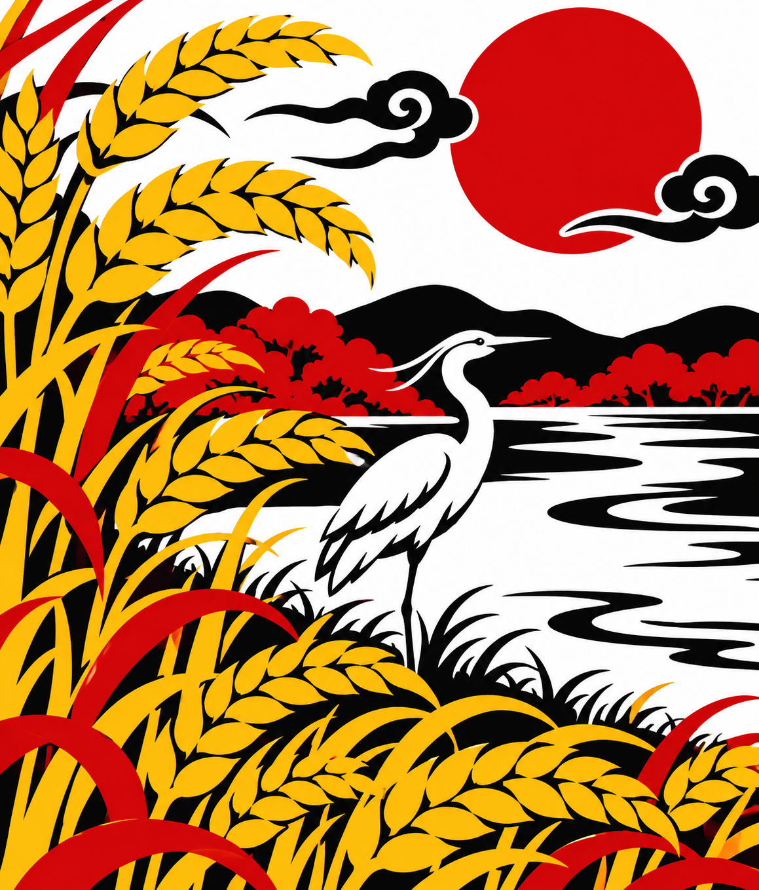
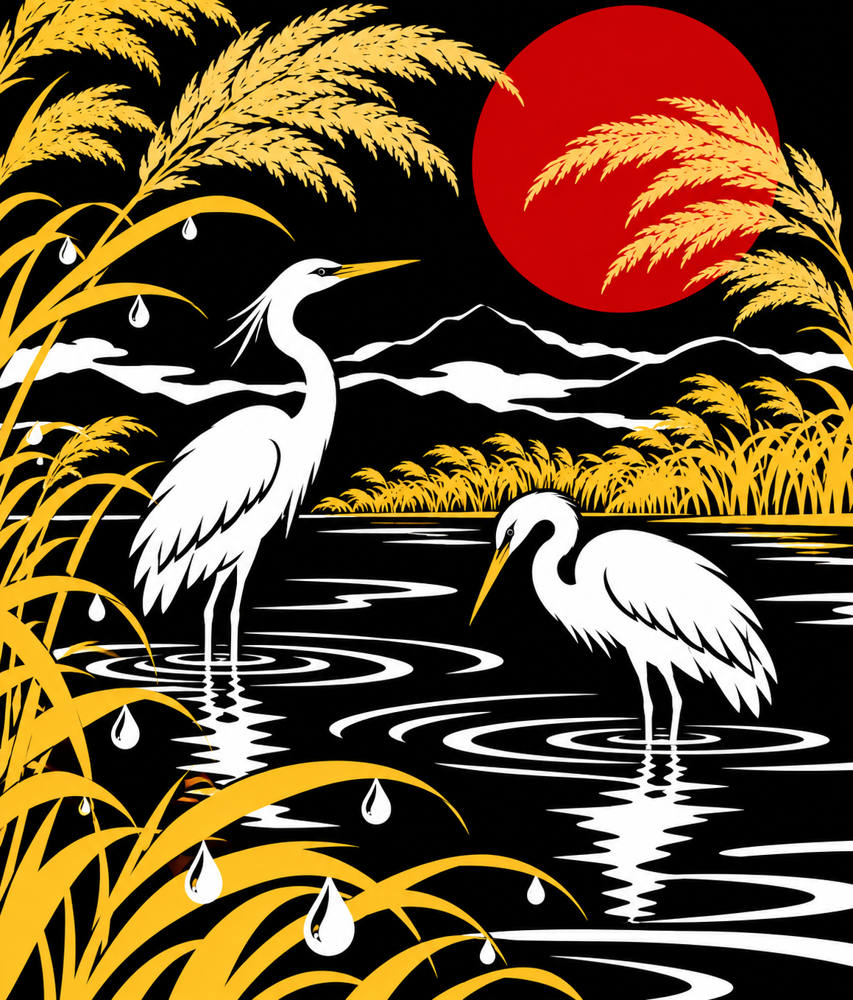
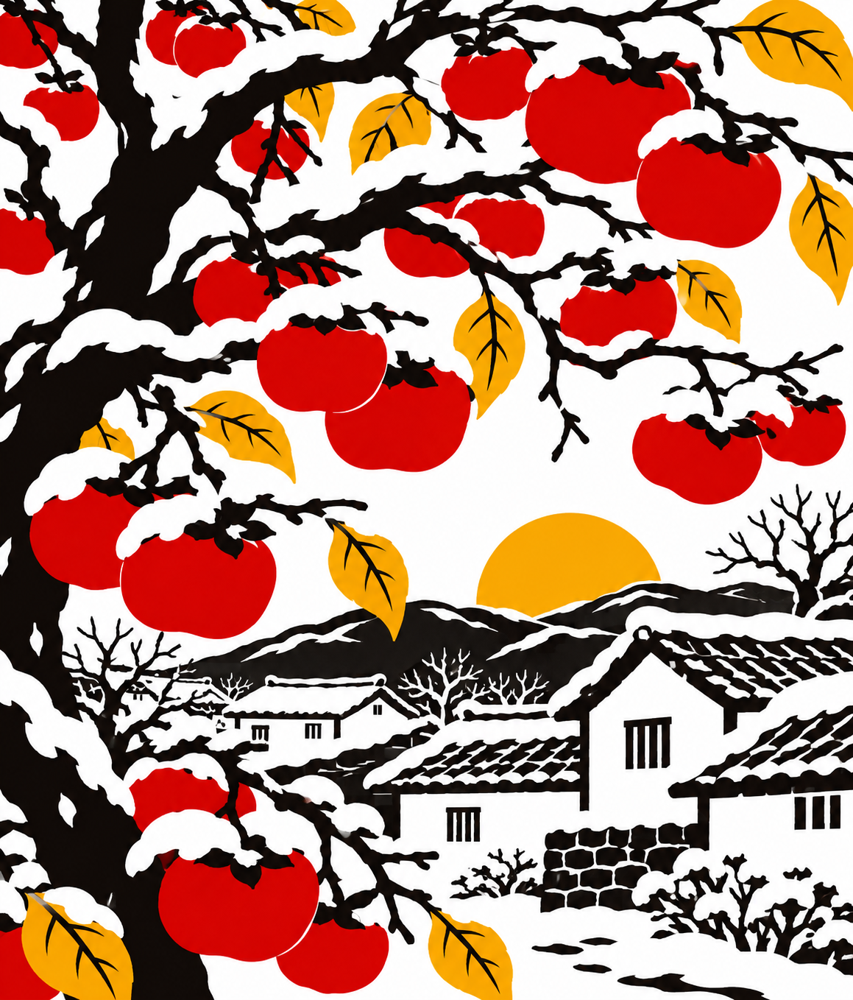
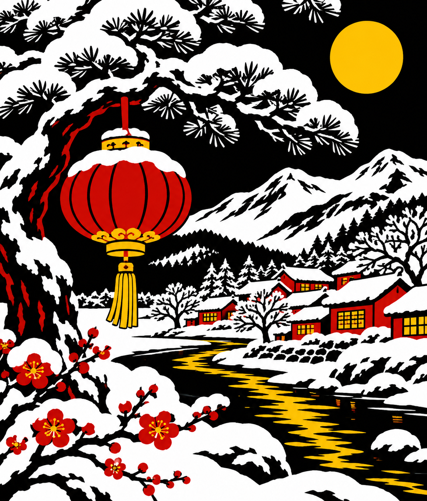

# ELINK 图片库

原 Image 目录 47 张原图全部保留原字节；新增 12 张节气主题壁纸。全屏图片与日历左图分目录存放。

- [全屏图片](full-screen/)：图片页选择全屏 400 × 300。
- [原有日历壁纸](calendar-wallpapers/originals/)：图片页选择日历左图 256 × 300。
- [每月节气壁纸](calendar-wallpapers/monthly/)：高分辨率原图（1159 × 1358，接近日历比例），网页自动识别并生成设备的 256 × 300 左图。
- [参考截图](full-screen/reference/)：原文件夹中的诊断截图，不是壁纸。

使用：下载 PNG → 图片页载入 → 确认日历左图 → 保存到设备空槽 → 图片日历读取图库并选择该槽 → 图片适配选择“专用日历图片”。旧槽若像素已经带白边，须重新保存原图到空槽。

新增图采用黑白红黄的剪纸/木刻风格，不含日期和文字；实际显示由网页按屏型量化。节气主题按月份安排，不代表指定年份的节气日期。原有素材的权利归原作者；新增素材由内置 ImageGen 生成。

| 月份 | 节气 | 图片 |
|---|---|---|
| 1 | 小寒 / 大寒 |  |
| 2 | 立春 / 雨水 |  |
| 3 | 惊蛰 / 春分 |  |
| 4 | 清明 / 谷雨 |  |
| 5 | 立夏 / 小满 |  |
| 6 | 芒种 / 夏至 |  |
| 7 | 小暑 / 大暑 |  |
| 8 | 立秋 / 处暑 |  |
| 9 | 白露 / 秋分 |  |
| 10 | 寒露 / 霜降 |  |
| 11 | 立冬 / 小雪 |  |
| 12 | 大雪 / 冬至 |  |
